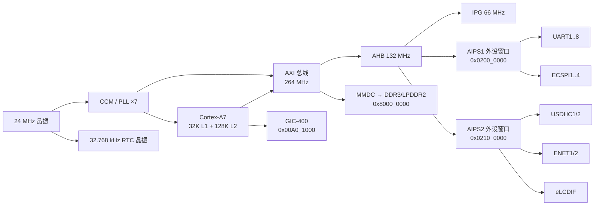

# 芯片全景与内存地图:先有一张地图,再谈启动

拿到一块新板子,最忌讳的就是"插上电、看日志、照着教程敲"。日志里出现的每一个地址——`0x87800000`、`0x021B0000`、`0x00900000`——都不是随便编的,它们对应芯片手册里的一张内存映射表。先把这张表看明白,后面 Boot ROM、DDR、时钟、存储、显示五章才有落脚点。

## 1.1 i.MX6ULL 是一颗什么样的芯片

i.MX6ULL 是 NXP i.MX6 家族里最"抠成本"的一档,和常见的 i.MX6UL 是同一颗 die 的不同配置:

| 项目 | i.MX6ULL |
| --- | --- |
| CPU | 单核 ARM Cortex-A7,典型 528 MHz,最高档位 900 MHz |
| 缓存 | 32 KiB L1 I-cache + 32 KiB L1 D-cache,128 KiB L2 |
| 片上 SRAM | 128 KiB OCRAM(`0x0090_0000`) |
| 内存 | 16 位 DDR3/DDR3L/LPDDR2,最高 400 MHz 时钟 |
| 启动介质 | SD/eMMC、NAND、NOR、QSPI、SPI EEPROM、USB 串行下载 |
| 图形 | 无 GPU、无 VPU,只有 eLCDIF 和 PXP(2D 加速) |
| 网络 | 2 路 10/100 ENET(带 IEEE 1588) |
| 其他 | 2×CAN、8×UART、4×I2C、4×ECSPI、2×USDHC、USB OTG、SAI、ADC |

"无 GPU、无 VPU、单核 A7"这几个减法,正是它便宜、功耗低、又足够跑 Linux 的原因。对本项目来说,它刚好够驱动一块 1024×600 的 RGB 屏、双网口、CAN、音频和一堆传感器。

## 1.2 从晶振到外设:一颗 SoC 的内部结构

几个关键点:

- **CPU 只认识地址**。访问 DDR 是访问 `0x8000_0000` 起的地址,访问 UART1 是访问 `0x0202_0000` 起的地址,没有任何区别,区别只在总线译码器把它们送到哪个控制器。
- **PLL 只能升频,不能凭空造时钟**。所有高速时钟最终都来自 24 MHz 晶振,由 CCM(Clock Controller Module)里的 7 个 PLL 倍频,再经过选择器和分频器分发到各外设。
- **外设挂在不同速度的总线上**。CPU/DDR 走 AXI,高速外设走 AHB,慢速寄存器走 IPG(66 MHz)。这就是为什么读一个 UART 寄存器可能比读内存慢几十倍。

## 1.3 内存映射:一张表看懂所有地址

下面这张表是本项目会用到的部分,数值取自 NXP 手册,并与 QEMU 的 `hw/arm/fsl-imx6ul.c`、U-Boot 的 `imx-regs.h` 逐项核对过。

| 起始地址 | 大小 | 区域 | 说明 |
| --- | --- | --- | --- |
| `0x0000_0000` | 96 KiB | Boot ROM | 出厂固化,不可写,上电第一条指令在这里 |
| `0x0010_0000` | 32 KiB | CAAM 私有 RAM | 加密模块内部存储 |
| `0x0090_0000` | 128 KiB | OCRAM | 片内 SRAM,Boot ROM 的栈和早期代码用 |
| `0x0092_0000` | 384 KiB | OCRAM alias | 同一块 SRAM 的另一个映射窗口 |
| `0x00A0_0000` | — | A7 MPCore | GIC、SCU、私有定时器等 |
| `0x0200_0000` | 1 MiB | AIPS1 | UART、SPI、GPIO、CAN、PWM、GPT 等 |
| `0x0210_0000` | 1 MiB | AIPS2 | USDHC、ENET、LCDIF、MMDC 配置、IOMUXC 等 |
| `0x021B_0000` | 4 KiB | MMDC 配置 | DDR 控制器寄存器 |
| `0x0219_0000` | 16 KiB | USDHC1 | SD 卡槽 1 |
| `0x0219_4000` | 16 KiB | USDHC2 | SD 卡槽 2 / eMMC |
| `0x0202_0000` | 16 KiB | UART1 | 本项目的调试串口 |
| `0x021C_8000` | 4 KiB | eLCDIF | RGB 屏控制器 |
| `0x0218_8000` | 4 KiB | ENET1 | 网口 1 |
| `0x020B_4000` | 4 KiB | ENET2 | 网口 2 |
| `0x020E_0000` | 16 KiB | IOMUXC | 引脚复用与 pad 属性 |
| `0x020C_4000` | 16 KiB | CCM | 时钟控制 |
| `0x020C_8000` | 16 KiB | CCM_ANALOG | PLL、bandgap 等模拟部分 |
| `0x8000_0000` | 最大 2 GiB | DDR | 内核、rootfs、用户态全部住在这里 |

::: tip 怎么记
`0x0200_0000` 和 `0x0210_0000` 是两个"外设大楼",每个楼 1 MiB。楼里的房间号不是连续的,中间有大量空地——这些空地在真机上访问会触发总线错误,在 QEMU 里则可能直接让内核挂起。第 08 章会专门讲这个坑。
:::

## 1.4 三个必须记住的地址

初学阶段最容易混淆的是三个"看起来都像内存"的地址:

1. **`0x8780_0000`**:U-Boot 的运行地址(`CONFIG_TEXT_BASE`)。它落在 DDR 里,不是物理内存的起点。U-Boot 把自己链接到这里,启动时由 Boot ROM 或调试器把镜像搬过来。
2. **`0x8000_0000`**:DDR 的物理起点。Linux 内核通常加载到 `0x8200_0000`(偏移 32 MiB),设备树放在 `0x8300_0000`,避开头部的 U-Boot 和页表区域。
3. **`0x0090_0000`**:片内 OCRAM。Boot ROM 在 DDR 还没初始化时,只能把代码先放进这里跑;这也是为什么 i.MX6 的早期启动代码必须"位置无关"或者链接到 OCRAM。

## 1.5 本板用到了哪些外设

板级设备树 `driver/device_tree/alpha-board/linux/imx6ull-aes.dtsi` 写得很清楚,挑出和启动链、教学相关的部分:

| 外设 | 控制器 | 板上器件 | 备注 |
| --- | --- | --- | --- |
| 调试串口 | UART1 `0x0202_0000` | CH340/板载 USB 转串口 | 115200 8N1,`stdout-path` |
| SD/eMMC | USDHC1/2 | SD 卡槽 + 8 位 eMMC | eMMC non-removable |
| 显示 | eLCDIF | 1024×600 RGB 屏 | 51.2 MHz 像素时钟 |
| 触摸 | I2C1 + GPIO | GT9147 | 中断 + 复位脚 |
| 音频 | SAI2 + I2C1 | WM8960 | 只做控制面教学 |
| 网口 | ENET1/2 | KSZ8081 PHY ×2 | 双网口 |
| CAN | FlexCAN1/2 | TJA1050 收发器 | 2 路 |
| 传感器 | I2C1 / ECSPI3 | AP3216C、ICM20608 | 教学用 |
| 存储扩展 | QSPI | N25Q256A | 256 Mbit NOR |

## 1.6 地址是怎么"查"出来的

不要背表,学会查:

- **手册**:IMX6ULLRM 的 "Memory Map" 一章有完整表格,按外设名索引。
- **U-Boot**:`arch/arm/include/asm/arch-mx6/imx-regs.h` 里全是 `MX6ULL_xxx_BASE_ADDR` 宏,和手册一一对应。
- **QEMU**:`include/hw/arm/fsl-imx6ul.h` 把每个外设的地址、大小都列成了枚举,写模型时直接引用。
- **Linux 设备树**:`soc` 节点下每个 `reg = <...>` 就是地址和长度,`compatible` 是驱动匹配名。

三者对照,任何一处对不上,基本就能定位是"手册看错""代码写错"还是"模型没实现"。

## 1.7 QEMU 视角:地址空洞与桩设备

QEMU 的 `mcimx6ul-evk` 机器并不是把手册里所有外设都实现了。它把地址空间分成三类:

- **真模型**:UART、SDHCI、FEC、LCDIF(11.1 起)、GPT、GPIO 等,行为接近硬件。
- **桩设备**:`create_unimplemented_device()`,读返回 0、写丢弃,只保证"访问不报错"。
- **空洞**:地址根本没注册,一访问就触发 external abort,内核直接挂。

这正是本项目要维护 27 个 QEMU 补丁的原因:把启动链上"必须能读回合理值"的寄存器补成模型(SCU 兼容窗口、PMU_MISC0、MMDC 几何、uSDHC quirk),把"访问到就死"的地方补成桩(AIPS 配置、SNVS、system counter)。

第 02 章就从 `0x0000_0000` 的 Boot ROM 开始,看第一条指令是怎么跑起来的。

::: details 延伸阅读
- NXP i.MX6ULL 产品页:<https://www.nxp.com/products/i.MX6ULL>
- i.MX6ULL 数据手册(IMX6ULLCEC):<https://www.nxp.com/docs/en/data-sheet/IMX6ULLCEC.pdf>
- 本仓库 QEMU 地址定义:`third_party/qemu/include/hw/arm/fsl-imx6ul.h`
- 本仓库 U-Boot 地址定义:`third_party/uboot-mainline/arch/arm/include/asm/arch-mx6/imx-regs.h`
:::
