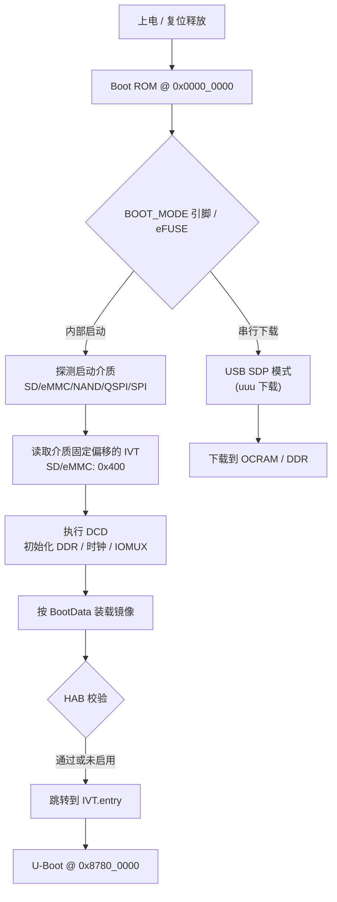

# Boot ROM、IVT 与 .imx 镜像:上电后的第一微秒

按下电源键之后,CPU 并不会直接跳到你的 U-Boot。中间还有一段你改不了的代码——Boot ROM。它决定了芯片从哪块介质启动、镜像长什么样、DDR 由谁初始化,以及为什么 `u-boot-dtb.imx` 不能简单当成一个二进制文件塞进 QEMU。

## 2.1 复位之后发生了什么

i.MX6ULL 的 Boot ROM 是 NXP 在生产时烧进芯片的 96 KiB 代码,物理地址从 `0x0000_0000` 开始。上电复位释放后,CPU 的第一条指令就在这里。



注意两件事:

1. **ROM 不会打印任何启动日志**。串口一片空白时,可能它还在找镜像,也可能已经跳到一段没有串口输出的代码。静默不等于死机。
2. **ROM 只认固定格式**。镜像不是"从 0 开始的二进制",而是带 IVT、BootData、可选 DCD 的结构体。格式不对,ROM 直接换下一个启动设备,不给你任何提示。

## 2.2 IVT:32 字节的"身份证"

IVT(Image Vector Table)告诉 ROM:入口在哪、DCD 在哪、镜像装载到哪、自己这段结构在哪。

| 偏移 | 字段 | 含义 |
| --- | --- | --- |
| `+0x00` | header | 固定签名 `D1 00 20 40`(tag、长度 0x20、版本 0x40) |
| `+0x04` | entry | 程序入口的**物理地址** |
| `+0x08` | reserved1 | 保留,必须为 0 |
| `+0x0C` | dcd | DCD 的物理地址,0 表示没有 |
| `+0x10` | boot_data | BootData 的物理地址 |
| `+0x14` | self | IVT 自己的物理地址 |
| `+0x18` | csf | HAB 签名数据地址,未签名时为 0 |
| `+0x1C` | reserved2 | 保留,必须为 0 |

两个容易踩的坑:

- 头部 4 字节是**大端**存放的长度字段,而指针字段是**小端**。同一张表里混着两种字节序,是 i.MX 启动格式的"传统艺能"。
- `self` 必须是**物理地址**,不是文件偏移。ROM 会根据 `self` 和 BootData 反推各结构在文件里的位置。

## 2.3 BootData:装载范围

BootData 只有 12 字节:

| 偏移 | 字段 | 含义 |
| --- | --- | --- |
| `+0x00` | start | 镜像装载到的物理地址 |
| `+0x04` | length | 装载长度(覆盖整个镜像范围) |
| `+0x08` | plugin | 0 = 普通镜像,非 0 = plugin 模式 |

## 2.4 DCD:ROM 替你先初始化 DDR

DDR 上电后是一片"未训练"的模拟电路,必须先配置控制器、PHY、延时,才能读写。问题来了:如果镜像本身要装进 DDR,那是"先有鸡还是先有蛋"。

i.MX 的答案是 **DCD(Device Configuration Data)**:一段由 ROM 解释执行的寄存器写序列,在装载主镜像之前把 DDR、时钟、IOMUX 配好。DCD 的指令很少,最常用的是:

| 操作码 | 名称 | 用途 |
| --- | --- | --- |
| `0xCC` | WRITE | 向一个或多个寄存器写值(可带掩码/置位) |
| `0xCF` | CHECK | 轮询寄存器直到满足条件 |
| `0xC0` | NOP | 空操作 |

DCD 不是随便写:地址必须落在手册允许的范围内,长度、对齐、掩码都有约束。写错一条,ROM 可能整段拒绝,板子表现为"上电无反应"。

## 2.5 拆开本仓库真实的 `u-boot-dtb.imx`

理论说完,直接看真东西。下面是对 `out/uboot/u-boot-dtb.imx` 的实测解析(文件大小 936,960 字节):

```text
偏移 0x00: d1 00 20 40    IVT header(tag=0xD1, len=0x20, ver=0x40)
entry      = 0x8780_0000   ← U-Boot 运行地址
dcd        = 0x877F_F42C   ← 相对 self 偏移 0x2C
boot_data  = 0x877F_F420   ← 相对 self 偏移 0x20
self       = 0x877F_F400   ← 镜像装载基址
csf        = 0x0000_0000   ← 未签名
```

BootData 就紧跟在 IVT 后面:装载起点 `0x877F_F400`,长度 937,984 字节。

这个长度比文件本身(936,960 字节)多了 1,024 字节,不是随手写的。`tools/imximage.c:880` 的公式是:

```c
*header_size_ptr = ROUND((st_size + imximage_ivt_offset), 4096);
```

也就是「文件大小 + IVT 在介质上的偏移(0x400)」再向上取整到 4 KiB。936,960 + 1,024 = 937,984,正好是 4 KiB 的整数倍。ROM 会按这个长度装载,所以 BootData 必须把介质偏移算进去。

DCD 在文件偏移 `0x2C`,头部 `D2 01 E8 40`,长度 488 字节。里面只有**一条 WRITE 命令**,携带 60 组"地址-值"对:

| 目标 | 写次数 | 作用 |
| --- | --- | --- |
| MMDC(`0x021B_xxxx`) | 34 | DDR 时序、PHY、ZQ 校准 |
| IOMUXC(`0x020E_xxxx`) | 19 | DDR 引脚复用与驱动强度 |
| CCM(`0x020C_4xxx`) | 7 | 打开 DDR 相关时钟门控(CCGR) |

前 7 条写的正是 `0x020C4068` 起的 CCGR0~CCGR6。也就是说:**在你看到 U-Boot 之前,DDR 已经由 ROM 按这 60 条写配置好了**。U-Boot 的 `dram_init()` 不需要重新初始化 DDR,只需要"问一下"控制器:内存有多大。

## 2.6 为什么 `.imx` 要写在卡的 1 KiB 偏移

SD/eMMC 启动时,ROM 固定从卡的 **`0x400`(1024 字节)** 处读取 IVT。

而 `mkimage` 生成的 `.imx` 文件,IVT 在文件偏移 0。所以写入卡时必须整体后移 1 KiB:

```text
卡偏移 0x0000  ┌──────────────┐
               │  分区表/保留  │
卡偏移 0x0400  ├──────────────┤ ← .imx 从这里开始写
               │ IVT (32 B)    │
               │ BootData      │
               │ DCD (488 B)   │
               │ U-Boot 代码    │
               └──────────────┘
```

本项目的镜像脚本 `scripts/image_builder/build_imx6ull_image.sh` 正是这么做的(`dd` 到 1 KiB 偏移)。验证方法也很直接:

```bash
# 卡上 0x400 处的 16 字节,应该和 .imx 文件开头的 16 字节完全一样
cmp <(dd if=out/release-latest/images/imx6ull-aes-emmc.img bs=1 skip=$((0x400)) count=16 2>/dev/null) \
    <(dd if=out/uboot/u-boot-dtb.imx bs=1 count=16 2>/dev/null) && echo OK
```

还有第三个坐标容易混:**U-Boot 自己被链接到 `0x8780_0000`**,而镜像基址是 `0x877F_F400`,两者相差 `0xC00`。这 3 KiB 正好是"IVT + BootData + DCD + 对齐"占用的头部空间。`entry` 指向代码,`self` 指向头部,谁也不能少。

## 2.7 Boot ROM 的启动模式

`BOOT_MODE[1:0]` 两个引脚(或对应 eFUSE)决定大方向:

| 模式 | 含义 |
| --- | --- |
| `00` | 从熔丝配置启动 |
| `01` | 串行下载(USB SDP,`uuu` 用这个) |
| `10` | 内部启动(按 BOOT_CFG 引脚选介质) |
| `11` | 保留 |

内部启动时,`BOOT_CFG1/2/4` 进一步选择 SD、eMMC、NAND、QSPI、SPI,以及位宽、速度等细节。板上那几个拨码开关,拨的不是"电源",就是这几组配置位。

::: tip 救命模式
板子刷成砖时,把 BOOT_MODE 拨到 `01`(串行下载),用 USB 线连电脑,`uuu` 就能把任意镜像推进 OCRAM 运行,不需要任何可用存储。这是 bring-up 阶段最重要的保险。
:::

## 2.8 HAB:签名与信任链

生产设备可能要求镜像经过签名(High Assurance Boot)。IVT 的 `csf` 字段指向签名数据,ROM 用 eFUSE 里的根公钥哈希验证。开放模式下验证失败通常只报错不拦截;闭合模式(熔断后不可逆)会直接拒绝启动。

教学阶段保持 `csf = 0`、不要碰 `SEC_CONFIG` 熔丝。签名是产品化的话题,和"镜像格式对不对"是两件事。

## 2.9 QEMU 视角:没有 ROM 的机器

QEMU 的 `mcimx6ul-evk` 没有实现 Boot ROM、HAB、IVT/DCD 解析,也没有"从 SD 卡 0x400 读 IVT"的行为。所以:

- `-bios u-boot-dtb.imx` 不行:文件会被当成一段裸代码从地址 0 开始执行,IVT 没人解析。
- 正确做法是 `-device loader,file=out/uboot/u-boot-dtb.bin,addr=0x87800000,cpu-num=0`:直接把**去掉头部的** `u-boot-dtb.bin` 放到运行地址,并让 CPU 从那里取指。
- DDR 也不需要 DCD 初始化:QEMU 的内存模型一上电就是可读写的,`-m 512M` 直接给定大小。真正要模拟的是"U-Boot 如何**探测**内存大小"——这是第 03 章 MMDC 模型要解决的问题。

```bash
out/qemu/build/qemu-system-arm -M mcimx6ul-evk -m 512M \
  -device loader,file=out/uboot/u-boot-dtb.bin,addr=0x87800000,cpu-num=0 \
  -nographic
```

启动链在真机与 QEMU 上的差异,可以记成一张表:

| 阶段 | 真机 | QEMU |
| --- | --- | --- |
| 取指 | Boot ROM @ 0x0 | loader 直接设 PC |
| DDR 初始化 | DCD 60 条写 | QEMU 内存模型,无需初始化 |
| 内存大小 | U-Boot 读 MMDC | 需要 MMDC 几何模型(补丁 0020) |
| 启动介质 | ROM 从 SD 0x400 读 | `-drive if=sd,index=1` 挂块设备 |
| 签名 | HAB(可选) | 无 |

下一章就进入 DDR:看看那 34 条 MMDC 写到底在做什么,以及 U-Boot 是怎么从寄存器反推出"512 MiB"的。

::: details 延伸阅读
- IMX6ULLRM 第 8 章 System Boot(IVT/BootData/DCD/Boot mode 的权威定义)
- U-Boot 镜像工具:`third_party/uboot-mainline/tools/imximage.c`、`include/imximage.h`
- 本仓库镜像脚本:`scripts/image_builder/build_imx6ull_image.sh`
- 一份按步骤手搓 IVT/DCD 的教学资料:<https://dangvitin.github.io/linuxlearn/part1-foundations/ch07-boot-rom-ivt-dcd.html>
:::
