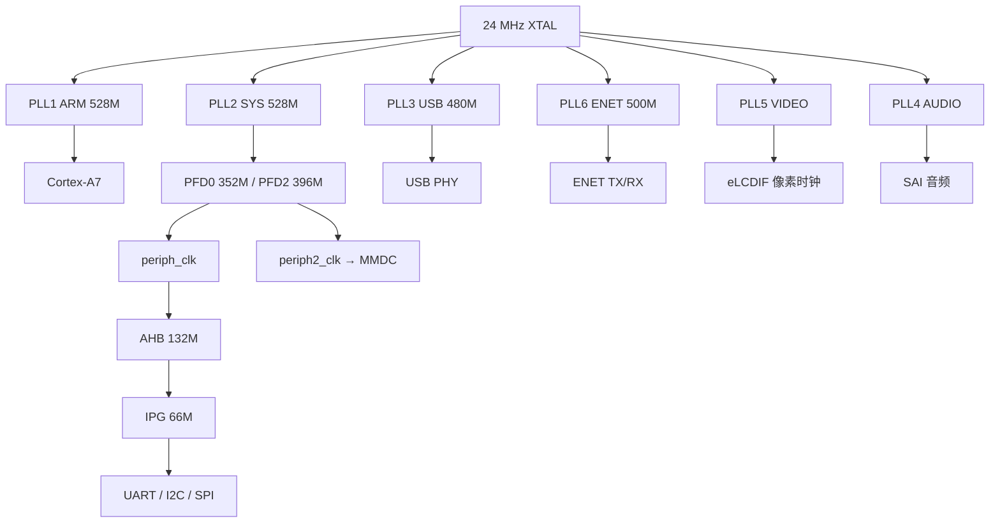

# 时钟与电源:从 24 MHz 到满速运行

一块板子上只有两种"心跳":24 MHz 主晶振和 32.768 kHz RTC 晶振。CPU、DDR、串口、SD 卡、屏幕的像素时钟,全都是从 24 MHz 倍频、分频出来的。时钟没配对,轻则串口乱码、SD 卡超时,重则内核卡在 `clocksource` 初始化。

## 4.1 七个 PLL

i.MX6ULL 的 CCM 里有 7 个锁相环,输入都是 24 MHz:

| PLL | 别名 | 典型输出 | 用途 |
| --- | --- | --- | --- |
| PLL1 | ARM_PLL | 528 MHz(最高档 900 MHz) | Cortex-A7 内核 |
| PLL2 | SYS_PLL / 528_PLL | 528 MHz(=24×22) | 系统总线、DDR、USDHC、UART 备选 |
| PLL3 | USB_PLL | 480 MHz(=24×20) | USB、UART 备选 |
| PLL4 | AUDIO_PLL | 分数分频,常见 786 MHz 附近 | SAI/音频 |
| PLL5 | VIDEO_PLL | 分数分频 | eLCDIF 像素时钟 |
| PLL6 | ENET_PLL | 500 MHz(24×20 + 分数) | 以太网 |
| PLL7 | USB_PLL(480) | 480 MHz | USB OTG |

PLL2 和 PLL3 是整数分频,倍频系数固定(×22、×20),通过 `CCM_ANALOG_PLL_SYS`/`PLL_USB1` 的 `DIV_SELECT` 位在 480/528 之间切换。PLL4/PLL5/PLL6 是分数分频,配置 `NUM/DENOM` 可以得到非整数倍频。

PLL2 还引出 4 个 PFD(Phase Fractional Divider):

| PFD | 典型频率 | 计算 | 常见用途 |
| --- | --- | --- | --- |
| PFD0 | 352 MHz | 528×18/27 | 系统备选、SAI |
| PFD2 | 396 MHz | 528×18/24 | MMDC(DDR 时钟) |

## 4.2 时钟树



几个容易混淆的时钟名:

- **periph_clk**:大部分外设的总线时钟,来自 PLL2 或 PLL2_PFD2,再分频。
- **periph2_clk**:MMDC 专用,和 periph_clk 分开,这样调 DDR 频率不影响外设。
- **AHB_CLK_ROOT**:periph_clk 再分频,典型 132 MHz。
- **IPG_CLK_ROOT**:AHB 再分频,典型 66 MHz,慢速寄存器都在这个域。
- **PERCLK**:IPG 或 24 MHz 晶振二选一,再分频,UART 常用。

## 4.3 CCM 的关键寄存器

| 寄存器 | 作用 |
| --- | --- |
| `CCR` | 时钟控制,包括 force 位 |
| `CCSR` | 时钟源选择(PLL1/2/3、PFD、24M) |
| `CBCDR` | AHB/IPG 分频、periph_clk 选择 |
| `CBCMR` | periph_clk2、pre_periph 选择 |
| `CSCMR1/2` | 各外设根时钟选择(USDHC、UART、CAN…) |
| `CDHIPR` | 分频握手状态 |
| `CCGR0~7` | 每个模块的时钟门控,2 位一组 |

`CCGR` 是最容易出问题的地方:某个外设的时钟门没开,寄存器读写可能"成功"但外设毫无反应。DCD 里对 CCM 的 7 次写,就是把 CCGR0~CCGR6 一次性写成 `0xFFFFFFFF`(全开),保证早期启动阶段没有门控坑。

## 4.4 U-Boot 和内核怎么用时钟

- **U-Boot** 里通过 `get_periph_clk()`、`mxc_get_clock()` 等函数取频率,再算分频。比如 UART 的波特率、USDHC 的卡时钟。
- **Linux 内核**通过设备树 `assigned-clocks`/`assigned-clock-parents` 在启动时设置父时钟。本板 LCDIF 就写死了父时钟:

```dts
&lcdif {
    assigned-clocks        = <&clks IMX6UL_CLK_LCDIF_PRE_SEL>;
    assigned-clock-parents = <&clks IMX6UL_CLK_PLL5_VIDEO_DIV>;
};
```

- 驱动里用 `clk_get_rate()` 拿到实际频率。**如果设备树时钟父节点配错,驱动算出来的分频就是错的**,表现为波特率偏差、SD 时钟超范围、屏幕花屏。

## 4.5 电源:被忽略的另一半

时钟之外,还有电压域:

| 域 | 典型电压 | 说明 |
| --- | --- | --- |
| VDD_ARM | 0.9–1.3 V | 随频率调整,超频必须抬压 |
| VDD_SOC | 0.9–1.2 V | 总线、大部分数字逻辑 |
| VDD_HIGH_CAP | 2.5 V | USB PHY、模拟 |
| VDD_SNVS | 3.0 V | RTC、SNVS |
| VDDIO | 1.8/3.3 V | 各外设 IO |

i.MX6ULL 内置 PMU(LDO/DCDC),不一定需要外部 PMIC;本项目的 U-Boot 就没有 PMIC 初始化代码。

### bandgap:一个让 U-Boot 死等的位

模拟电路需要一个参考电压(bandgap)。`CCM_ANALOG_PMU_MISC0` 的 bit7 `REFTOP_VBGUP` 表示 bandgap 已稳定。U-Boot 的 `init_bandgap()` 会轮询这一位,等不到就一直循环。

QEMU 早期把这个寄存器的复位值实现成 `0x04000000`(bit7=0),于是 U-Boot 卡死。补丁 `0018` 把它改成 `0x04000080`:

```diff
-    { .offset = PMU_MISC0, .reset = 0x04000000 },
+    { .offset = PMU_MISC0, .reset = 0x04000080 },
```

一行改动,解决"U-Boot 停在 bandgap 等待"的挂起。

## 4.6 时间基准:CNTFRQ 的坑

时钟章的最后,讲一个本项目实际踩过的坑,它同时涉及硬件和 QEMU 模型。

Cortex-A7 有一个通用定时器(ARM Generic Timer),频率由 `CNTFRQ` 寄存器描述。U-Boot 的 i.MX6ULL 配置使用 `CONFIG_SYSCOUNTER_TIMER`,在 `timer_init()` 里把 `CNTFRQ` 写成 8 MHz(`CFG_SC_TIMER_CLK`),然后 `get_tbclk()` 再读回来算时间。

问题在于 QEMU:

- `CNTFRQ` 的实现是 **reads-as-written**(写 8 MHz 就读回 8 MHz);
- 但计数器实际的递增频率由 CPU 的 `gt_cntfrq_hz` 决定,Cortex-A7 走 `ARM_FEATURE_BACKCOMPAT_CNTFRQ`,固定 **62.5 MHz**。

于是 U-Boot 以为 1 秒 = 8M 个计数,实际 1 秒 = 62.5M 个计数,显示的时间快了 `62.5/8 = 7.8125` 倍。表现是:

- `ext4load` 打印 `15883 ms`,实际墙钟只有约 2 秒;
- `cyclic function video_idle took too long` 告警;
- `bootdelay` 倒计时明显偏快。

补丁 `0027` 在 CPU realize 之前把 `cntfrq` 属性设成 8 MHz,让"写进去的值"和"计数频率"一致。这不是修 U-Boot,而是修模型与硬件行为的不一致。

::: tip 教学点
遇到"时间明显不对"时,先别怀疑硬盘慢。串口打印的毫秒数是**固件用自己的时基算的**,时基错了,一切耗时数据都不可信。用秒表或 `date` 对照一次,就能区分"真慢"和"算错"。
:::

## 4.7 QEMU 的 CCM 模型覆盖到哪里

QEMU 的 `hw/misc/imx6ul_ccm.c` 实现了:

- PLL2(528/480)、PLL3(480)、PFD0/PFD2 的频率计算;
- periph_clk / periph2_clk / AHB / IPG / PERCLK 的选择与分频;
- CCGR 门控的读写(不真正停时钟);
- 一部分外设根时钟(CLK_IPG、CLK_IPG_HIGH、CLK_32k、CLK_CAN)。

它不模拟 PLL 锁定时间、频率切换握手,也不模拟电压。对本项目的 U-Boot/内核启动足够;如果你要调 DDR 频率或做功耗测试,它帮不上忙。

下一章从"时间"转到"空间":一个引脚怎么被复用成 UART、SD 或 LCD,以及 `0x49` 这种神秘数字的含义。

::: details 延伸阅读
- IMX6ULLRM 的 Clock Controller Module 章节(PLL、PFD、CCGR 的完整定义)
- QEMU CCM 模型:`third_party/qemu/hw/misc/imx6ul_ccm.c`
- bandgap 补丁:`patches/qemu/0018-hw-misc-imx6ul_ccm-Update-PMU_MISC0-reset-value.patch`
- 时间基准补丁:`patches/qemu/0027-hw-arm-fsl-imx6ul-Program-the-generic-timer-at-8-MHz.patch`
:::
