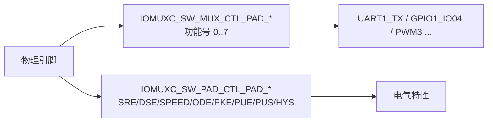

# 引脚复用与电气属性:IOMUXC 与 pad

i.MX6ULL 有 100 多个引脚,每个引脚最多能承担七八种功能。同一个物理引脚,今天可以是 UART 的 TX,明天可以是 PWM 输出,后天还能当普通 GPIO——靠的就是 IOMUXC(IO Multiplexer Controller)。

设备树里 `fsl,pins = <MX6UL_PAD_UART1_TX_DATA__UART1_DCE_TX 0x1b0b1>` 这一行,前半段决定"这个脚做什么",后半段决定"这个脚的电气特性"。很多人只会照抄后半段,出了问题也不知道从哪查。这一章把两半都讲清楚。

## 5.1 一个引脚的两层配置

每个引脚在 IOMUXC 里有两类寄存器:

1. **MUX 寄存器**:选择功能号 0~7,对应 `ALT0`~`ALT7`。写错功能号,信号就去不了外设。
2. **PAD 寄存器**:配置电气属性——上下拉、驱动强度、摆率、迟滞、开漏。写错不影响"通不通",但会影响"稳不稳"。



## 5.2 PAD 控制字的字段

i.MX6/IPAD 的 pad 控制寄存器位域大致如下(具体以手册 IOMUXC 章为准):

| 位 | 字段 | 含义 |
| --- | --- | --- |
| `0` | SRE | 摆率,1 = 快速 |
| `3-5` | DSE | 驱动强度,从 R0/1 到 R0/7 |
| `6-7` | SPEED | 速度档,低速/中速/高速/最大 |
| `11` | ODE | 开漏输出使能 |
| `12` | PKE | 保持器/上下拉使能 |
| `13` | PUE | 1 = 上拉,0 = 下拉(与 PUS 配合) |
| `14-15` | PUS | 上拉/下拉阻值:00 保持,01 22k,10 100k,11 22k(掉电) |
| `16` | HYS | 迟滞(施密特触发器)使能 |

于是 `0x1b0b1` 可以拆成:

```text
0x1b0b1 = 0001 1011 0000 1011 0001
  HYS = 1        (bit16)
  PUS = 10       (bit14-15)  → 100k 上拉
  PUE = 1        (bit13)
  PKE = 1        (bit12)
  SPEED = 10     (bit6-7)    → 中速
  DSE = 110      (bit3-5)    → 较强驱动
  SRE = 1        (bit0)      → 快速摆率
```

这组配置(UART1 的 TX/RX)意味着:上拉保证空闲电平,迟滞抗干扰,中速+快速摆率适合 115200 这种不算高的波特率。

再看 USDHC2 用的 `0x17059`:

```text
0x17059 → HYS=1, PUS=01(22k 上拉), PUE=1, PKE=1, SPEED=01, DSE=011
```

SD 卡的 CMD/DATA 线是双向的,空闲时需要上拉,所以 22k 上拉 + 迟滞是标准配置。

## 5.3 本板几组典型引脚

### UART1(调试串口)

```dts
pinctrl_uart1: uart1grp {
    fsl,pins = <
        MX6UL_PAD_UART1_TX_DATA__UART1_DCE_TX 0x1b0b1
        MX6UL_PAD_UART1_RX_DATA__UART1_DCE_RX 0x1b0b1
    >;
};
```

`DCE_TX`/`DCE_RX` 里的 DCE 指数据通信设备方向。如果板子当 DTE(像 PC 串口)用,就要换 `DTE` 变体,否则收发会反。

### USDHC2(eMMC)

```dts
pinctrl_usdhc2: usdhc2grp {
    fsl,pins = <
        MX6UL_PAD_NAND_RE_B__USDHC2_CLK     0x17059
        MX6UL_PAD_NAND_WE_B__USDHC2_CMD     0x17059
        MX6UL_PAD_NAND_DATA00__USDHC2_DATA0 0x17059
        ...
        MX6UL_PAD_NAND_DATA03__USDHC2_DATA3 0x17059
    >;
};
```

注意 `imx6ull-aes.dtsi` 里只列了 `DATA0~DATA3`。但最终生效的板级 `imx6ull-aes.dts` 又覆盖了一次:

```dts
&usdhc2 {
    pinctrl-0 = <&pinctrl_usdhc2_8bit>;
    bus-width = <8>;
    non-removable;
};
```

所以真机上的 USDHC2 是 **8 位 eMMC**,dtsi 里那组 4 位 pinmux 只是被覆盖的中间状态。这提醒一件事:**看设备树不能只看 `.dtsi`,要沿着 `#include` 和 `&override` 找到最终生效的节点**。在 QEMU 里,SD 模型只支持 4 位,所以 `mmc info` 会显示 `Bus Width 4-bit`——这是模型限制,不是设备树写错。

### LCDIF(24 位 RGB)

```dts
pinctrl_lcdif_dat: lcdifdatgrp {
    fsl,pins = <
        MX6UL_PAD_LCD_DATA00__LCDIF_DATA00 0x49
        ...
        MX6UL_PAD_LCD_DATA23__LCDIF_DATA23 0x49
    >;
};

pinctrl_lcdif_ctrl: lcdifctrlgrp {
    fsl,pins = <
        MX6UL_PAD_LCD_CLK__LCDIF_CLK      0x49
        MX6UL_PAD_LCD_ENABLE__LCDIF_ENABLE 0x49
        MX6UL_PAD_LCD_HSYNC__LCDIF_HSYNC  0x49
        MX6UL_PAD_LCD_VSYNC__LCDIF_VSYNC  0x49
    >;
};
```

`0x49` 非常"素":没有上下拉、没有迟滞,只有快速摆率和最小档驱动。RGB 屏是点对点短走线,不需要上下拉;驱动太强反而会过冲,所以用低档。这是"按信号类型选 pad 参数"的典型例子。

## 5.4 U-Boot 里的引脚配置

U-Boot 有两种配引脚的方式:

1. **板级 C 代码**:老式 `iomux_v3_cfg_t` 数组,例如本板 `setup_lcd()` 里给背光 GPIO 配的 `MX6_PAD_GPIO1_IO08__GPIO1_IO08`。
2. **设备树 + DM 驱动**:新式 U-Boot 从 `u-boot.dtsi`/板级 dts 里读 pinctrl,UART、SD、FEC、QSPI 都走这条路。

本板还保留了一处必须用 C 代码处理的:以太网参考时钟。`setup_fec()` 里:

```c
/* ENET1: clear gpr1[13], set gpr1[17] */
clrsetbits_le32(&iomuxc_regs->gpr[1], IOMUX_GPR1_FEC1_MASK,
                IOMUX_GPR1_FEC1_CLOCK_MUX1_SEL_MASK);
/* ENET2: clear gpr1[14], set gpr1[18] */
clrsetbits_le32(&iomuxc_regs->gpr[1], IOMUX_GPR1_FEC2_MASK,
                IOMUX_GPR1_FEC2_CLOCK_MUX1_SEL_MASK);

enable_fec_anatop_clock(0, ENET_50MHZ);
enable_fec_anatop_clock(1, ENET_50MHZ);
enable_enet_clk(1);
```

这里操作的是 **IOMUXC_GPR1**,不是普通 pad 寄存器——它管的是 ENET 的参考时钟从哪来(ANATOP 50 MHz 回环,还是外部晶振)。配错的表现是:PHY 能读到 ID,但 ping 不通,或者链路反复 up/down。

## 5.5 常见坑对照表

| 现象 | 可能原因 |
| --- | --- |
| 串口完全无输出 | TX 脚 MUX 选错;或波特率时钟源不对 |
| 串口能收不能发 | TX/RX 的 DCE/DTE 方向反了 |
| SD 卡时好时坏 | CMD/DATA 上拉不对,或 DSE 太弱 |
| 屏幕花屏/闪 | LCD 时钟 pad 驱动过强、走线过长,或 DSE 档位不对 |
| PHY 识别不到 | ENET 参考时钟 GPR1 配置错,或 REF_CLK pad 复用错 |
| GPIO 读不到按键 | 上拉/下拉配反,或 PKE/PUE 没开 |
| 引脚发热/功耗高 | 输出脚被外部拉低,或 ODE 开漏配置错误 |

## 5.6 怎么自己查

1. **手册**:IMX6ULLRM 的 IOMUXC 章有每个 pad 的 ALT 表,以及 pad 控制寄存器位域。
2. **头文件**:`arch/arm/include/asm/arch-mx6/mx6ull_pins.h`(U-Boot)或 `arch/arm/boot/dts/nxp/imx/imx6ul-pinfunc.h`(内核)里,`MX6UL_PAD_xxx__FUNC` 宏已经编好了 mux 寄存器、功能号。
3. **实测**:U-Boot 下 `md.l <mux_reg>`、`md.l <pad_reg>` 看当前值;Linux 下 `cat /sys/kernel/debug/pinctrl/*/pinmux-pins` 看哪个驱动占了哪个脚。

## 5.7 QEMU 视角

QEMU 不模拟引脚复用:写 MUX/PAD 寄存器不会改变任何外设行为,也不会因为 pad 配错而丢信号。UART、SD、LCD 的模型直接工作,不管你有没有配对引脚。

这带来一个教学上的取舍:QEMU 能帮你验证"驱动逻辑、时钟、数据通路",但验证不了"硬件连线与电气"。真机 bring-up 时,pinctrl 仍然是第一批要查的东西。

下一章进入存储:SD 卡插上去之后,控制器和卡之间到底发生了什么,以及为什么 U-Boot 需要那么多 quirk 才能在 QEMU 里读卡。

::: details 延伸阅读
- IMX6ULLRM 的 IOMUXC 章节(ALT 表与 pad 控制位域)
- 本板引脚定义:`driver/device_tree/alpha-board/linux/imx6ull-aes.dtsi` 的 `pinctrl_*` 节点
- U-Boot 引脚宏:`third_party/uboot-mainline/arch/arm/include/asm/arch-mx6/mx6ull_pins.h`
- 内核 pinctrl 文档:<https://docs.kernel.org/driver-api/pinctl.html>
:::
