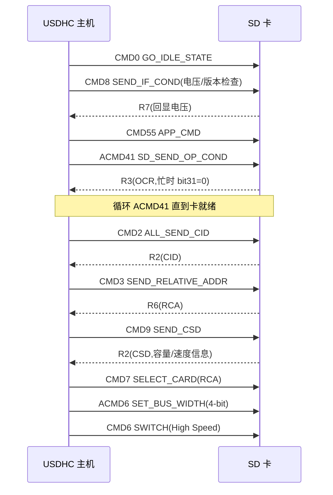

# SD/eMMC 与 USDHC:启动介质

对一块没有 NAND、没有 SPI Flash 的板子,SD 卡和 eMMC 就是"硬盘 + 启动盘"。U-Boot、内核、设备树、rootfs 全在里面。这一章从上电那一刻卡的状态讲起:控制器怎样找到卡、发哪些命令、数据怎么搬,以及为什么本项目的 QEMU 需要 4 个 uSDHC 补丁才能让 U-Boot 读卡。

## 6.1 SD 卡不是"上电就能读"

SD 卡上电后处于 idle 状态,必须经过一套标准流程才能读写:



几个关键点:

- **CMD8** 用来确认卡支持 2.7–3.6 V 和 SD 2.0 协议。老卡不回 R7,主机要回退到 SD 1.x 流程。
- **ACMD41** 是"卡上电完成没有"的轮询。卡内部做上电初始化,没完成时 OCR 的 busy 位为 0。U-Boot 报 `Card did not respond to voltage select!` 就是这一步超时。
- **CMD2/CMD3** 拿 CID 和 RCA。RCA 是卡的"短期地址",后续命令都用它寻址。
- **CMD9** 读 CSD,里面有能力信息:最大时钟、块长度、容量。
- **CMD6** 切换到 High Speed 模式,总线时钟从 25 MHz 提到 50 MHz。

## 6.2 数据怎么搬:CMD17/18/24/25

初始化完成后,读写靠几条命令:

| 命令 | 作用 |
| --- | --- |
| CMD17 | 读单个块(512 B) |
| CMD18 | 读多个块,直到 CMD12 停止 |
| CMD24 | 写单个块 |
| CMD25 | 写多个块 |
| CMD12 | 停止多块传输 |

数据通路有三种:

- **PIO**:CPU 一个 FIFO 一个 FIFO 地搬,慢,但简单。
- **SDMA**:控制器用物理连续缓冲区搬,一次传输有 512 KiB 边界限制(SD 规范)。
- **ADMA2**:用描述符表,支持分散/聚集,现代系统常用。

U-Boot 的 `fsl_esdhc_imx` 用 SDMA(有些平台用 ADMA)。这就埋下了本项目补丁 0024 的伏笔。

## 6.3 USDHC 控制器

i.MX6ULL 的两个 USDHC 是 SDHCI 兼容控制器:

| 基址 | 实例 | 本板用途 |
| --- | --- | --- |
| `0x0219_0000` | USDHC1 | SD 卡槽(TF 卡) |
| `0x0219_4000` | USDHC2 | 8 位 eMMC / 也可接 SD |

它们大部分寄存器遵循 SDHCI 标准,但 i.MX 加了一个 **VEND_SPEC** 寄存器,用于厂商特性:

- **时钟门控**:`IPGEN`、`HCKEN`、`PEREN`、`CKEN` 四个位,分别控制 IPG 时钟、AHB 时钟、外设时钟、卡时钟。少开一个,控制器就"活着但不动"。
- **SDCLK 自动门控**、**burst 长度**、**tuning** 等。

U-Boot 的 `fsl_esdhc_imx.c` 会先 `clk_get_rate(&priv->per_clk)` 拿外设时钟,再算分频;如果时钟框架返回 0,分频就无从谈起——这是启动链上很隐蔽的一类挂起。

## 6.4 为什么 QEMU 需要 4 个 uSDHC 补丁

上游 QEMU 的 SDHCI 模型是按"标准 SDHCI"写的,而 U-Boot 的 i.MX 驱动按真实 uSDHC 的行为写。两者对不上,就出现"Linux 能读卡,U-Boot 不能"的怪现象。补丁 0021–0024 分别修了四处:

| 补丁 | 问题 | 修法 |
| --- | --- | --- |
| 0021 | U-Boot 用内部 quirk 位表示"无 busy IRQ",和 QEMU 的位定义冲突 | 把 `SDHCI_QUIRK_NO_BUSY_IRQ` 从 BIT(14) 挪到 BIT(0) |
| 0022 | U-Boot 只开 VEND_SPEC 的时钟门,QEMU 却只看标准寄存器 | 新增 `SDHCI_QUIRK_CLOCKS_IN_VENDOR`,认可 IPGEN/HCKEN/PEREN/CKEN |
| 0023 | U-Boot 初始化后二次 RSTA,把中断使能清掉 | RSTA 路径保留 `norintstsen`/`errintstsen` |
| 0024 | SDMA 多块传输在 512 KiB 边界停下,等一个不会来的中断 | 新增 `SDHCI_QUIRK_NO_SDMA_BOUNDARY`,i.MX 不按边界停 |

这四条合起来,才让"U-Boot 从 SD 卡读 zImage"在 QEMU 里成立。补丁 0022 尤其典型:它不是在修 bug,而是在修**模型与真实芯片行为之间的差异**。

## 6.5 镜像布局:一张卡上的三个世界

本项目的镜像(`out/release-latest/images/imx6ull-aes-emmc.img`)布局如下:

```text
偏移 0x0000_0000  ┌────────────────────┐
                  │ MBR 分区表          │
偏移 0x0000_0400  ├────────────────────┤
                  │ U-Boot .imx (1 KiB) │  ← Boot ROM / loader 从这里取
偏移 0x0010_0000  ├────────────────────┤  (16 MiB)
                  │ p1: ext4 64 MiB     │  /zImage、/imx6ull-aes.dtb、/boot.scr
偏移 0x0050_0000  ├────────────────────┤  (80 MiB)
                  │ p2: ext4 40 MiB     │  rootfs
                  └────────────────────┘
```

为什么 p1 从 16 MiB 开始?两个原因:

1. 给 U-Boot 和后续可能的分区表/环境区留足空间(环境区在 4 MiB)。
2. SD 卡按块寻址,16 MiB 对齐对性能和兼容性都友好。

U-Boot 的环境区固定在 `0x0040_0000`(4 MiB),8 KiB,由镜像脚本从 U-Boot ELF 里提取默认环境、补 CRC 后写入。第 08 章会讲为什么不能只写一个 `bootcmd`。

## 6.6 U-Boot 读卡的完整路径

把前面几章串起来,`ext4load mmc 1:1 ${loadaddr} /zImage` 这一条命令背后是:

1. **mmc 1**:选中 USDHC2(设备号由驱动 probe 顺序决定)。
2. **初始化**:上电、发 CMD0/CMD8/ACMD41/CMD2/CMD3/CMD9/CMD7、切 4 位、切 High Speed。
3. **分区解析**:读 MBR,找到 p1 的起始 LBA 和长度。
4. **文件系统**:ext4 驱动读超级块、组描述符、inode,找到 `/zImage` 的数据块。
5. **数据搬运**:SDMA 按块读,每次 512 B 或更大,直到文件读完。
6. **校验**:可选,读完后通常直接 `bootz`。

本项目实测:9.26 MB 的 zImage 约 2.0 秒读完,约 **4.4 MiB/s**。这个速度受限于 QEMU 的 SD 模型和 SDMA 实现,不代表真机性能(真机 High Speed 4 位理论上限 25 MB/s)。

## 6.7 eMMC 与 SD 的差异

| 维度 | SD 卡 | eMMC |
| --- | --- | --- |
| 总线宽度 | 1/4 位 | 1/4/8 位 |
| 可插拔 | 是 | 否(non-removable) |
| 启动分区 | 无 | boot0/boot1,可存 bootloader |
| 分区 | MBR/GPT | 用户区 + boot 区 + RPMB |
| 命令集 | SD 命令 | MMC 命令(部分不同) |
| 本项目 | 卡槽 | 8 位,`non-removable` |

设备树里 `&usdhc2 { non-removable; }` 告诉内核"别去检测卡",直接初始化。QEMU 没有 eMMC 模型,`mcimx6ul-evk` 对两个 USDHC 都挂 `TYPE_SD_CARD`,所以镜像里的 eMMC 语义在 QEMU 上表现为一张 SD 卡——这也是第 02 章说"QEMU 与真机有差异"的一个具体例子。

## 6.8 常见故障

| 日志 | 含义 | 排查 |
| --- | --- | --- |
| `Card did not respond to voltage select! : -110` | ACMD41 超时 | 卡没插好、电压不对、控制器时钟没开 |
| `MMC: no card present` | CD 脚检测不到卡 | CD GPIO 复用/上拉错 |
| `mmc_init: -95` | 初始化失败 | 总线宽度或时钟配置错 |
| `** Unrecognized filesystem type **` | 分区不对 | p1 没格式化或起始偏移错 |
| `Failed to load '/zImage'` | 文件不存在 | 镜像没打包进去,或路径写错 |
| 读卡极慢 | SDMA/时钟问题 | 检查 VEND_SPEC 时钟门、总线宽度 |

::: tip 一个实用技巧
U-Boot 下先 `mmc list` 看设备号,再 `mmc dev 1`、`mmc info` 看容量和总线宽度,最后才 `ext4ls`。一步一步来,出错时能立刻知道卡在哪一步。
:::

下一章看 bring-up 的"两只眼睛":串口和屏幕。一个告诉你系统活没活,一个告诉你画面对不对。

::: details 延伸阅读
- IMX6ULLRM 的 uSDHC 章节(寄存器与 VEND_SPEC)
- U-Boot 驱动:`third_party/uboot-mainline/drivers/mmc/fsl_esdhc_imx.c`
- 四个 quirk 补丁:`patches/qemu/0021`~`0024`
- SD 规范(简化版):<https://www.sdcard.org/downloads/pls/>
:::
