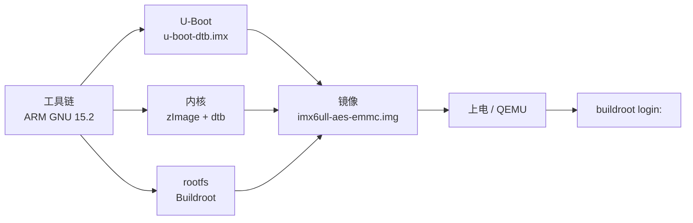
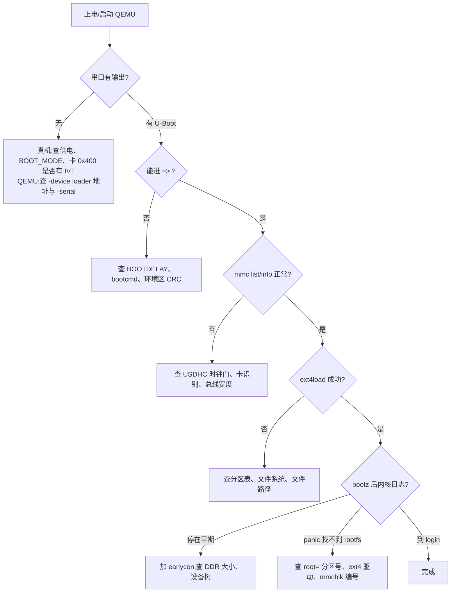

# 把全流程串起来:从裸片到 login

前面七章分别讲了 SoC、Boot ROM、DDR、时钟、引脚、存储、串口和屏幕。这一章把它们拼成一条完整的链路,并给出本仓库里每一步对应的脚本、产物和验收标准。

## 8.1 全流程一览



| 步骤 | 命令 | 产物 | 验收 |
| --- | --- | --- | --- |
| 1. 工具链 | 解压到 `/opt/arm-gnu-toolchain` | `arm-none-linux-gnueabihf-gcc` | `--version` 能打印 |
| 2. U-Boot | `./scripts/build_helper/build-uboot.sh` | `out/uboot/u-boot-dtb.imx` | 串口出现 `U-Boot 2026.10` |
| 3. 内核 | `./scripts/build_helper/build-linux.sh` | `out/linux/arch/arm/boot/zImage` + `imx6ull-aes.dtb` | 能解压、能挂 rootfs |
| 4. rootfs | `./scripts/build_helper/build-buildroot.sh` | `out/release-latest/rootfs/` | 有 `/sbin/init`、`/bin/sh` |
| 5. 镜像 | `./scripts/image_builder/build_imx6ull_image.sh --boot-media=emmc` | `out/release-latest/images/imx6ull-aes-emmc.img` | 分区表、U-Boot、boot.scr、env 齐全 |
| 6. 启动 | `run-qemu.sh` 或真机 | `buildroot login:` | 无手工输入即可到 login |

## 8.2 每一步背后发生了什么

### 步骤 1:工具链

交叉编译器决定了 ABI、glibc 版本、内核头文件版本。本项目用 ARM GNU Toolchain 15.2.rel1(`arm-none-linux-gnueabihf-`),U-Boot、内核、Buildroot 三处必须用同一套,否则会出现"能编译、运行时报 `Illegal instruction`"或 glibc 符号缺失。

### 步骤 2:U-Boot

U-Boot 的构建分两段:编译 + 打包成 `.imx`。

- 编译产物:`u-boot`(ELF)、`u-boot.bin`(裸二进制)、`u-boot.dtb`(控制用设备树)。
- 打包:`mkimage` 把 `u-boot-dtb.bin` 加上 IVT/BootData/DCD,生成 `u-boot-dtb.imx`。
- 镜像脚本再把 `.imx` 写到卡的 1 KiB 偏移。

板级配置的关键项:

```text
CONFIG_TEXT_BASE=0x87800000
CONFIG_BOOTDELAY=2
CONFIG_BOOTCOMMAND="if ext4load mmc 1:1 ${loadaddr} /boot.scr; then source ${loadaddr}; ..."
CONFIG_ENV_IS_IN_MMC=y
CONFIG_ENV_MMC_DEVICE_INDEX=1
```

`BOOTDELAY=2` 给用户 2 秒中断机会;`BOOTCOMMAND` 优先从 USDHC2 的 p1 读 `boot.scr`,失败再回退 USDHC1。

### 步骤 3:内核

`build-linux.sh` 做三件容易被忽略的事:

1. 用模板 `imx6ull_mainline_defconfig.template` 生成 `imx_aes_mainline_defconfig`(把固件路径替换进去)。
2. 把板级 `imx6ull-aes.dts/.dtsi` 拷进内核树,并在 Makefile 里注册 dtb。
3. 编译 `zImage` 和 `imx6ull-aes.dtb`。

所以内核树本身是"干净上游",板级改动全部来自 `driver/device_tree/alpha-board/linux/`。这也是为什么升级内核版本时,板级适配不会丢。

### 步骤 4:rootfs

Buildroot 用外部工具链 + 自定义 defconfig 构建最小系统:BusyBox、init、getty、alsa、常用工具。产物不直接是镜像,而是一棵目录树,由第 5 步打包。

### 步骤 5:镜像

`build_imx6ull_image.sh` 做四件事:

1. 建 MBR 分区表:p1 从 16 MiB 开始,p2 紧随其后。
2. 把 `.imx` 写到 1 KiB 偏移。
3. 在 p1 里放 `zImage`、`dtb`、`boot.scr`,并用 `mkimage -T script` 生成脚本。
4. 从 U-Boot ELF 提取默认环境、补 CRC,写到 4 MiB 偏移(8 KiB 环境区)。

### 步骤 6:启动

真机:拨码选 SD/eMMC,上电,Boot ROM 读 IVT、执行 DCD、装载 U-Boot。
QEMU:用 `-device loader` 把 `u-boot-dtb.bin` 放到 `0x87800000`,省掉 ROM 和 DCD。

## 8.3 一次实测的启动时序

下面是从本项目实测日志里摘出来的(无人值守):

```text
U-Boot 2026.10-dirty
CPU:   Freescale i.MX6UL rev1.0
DRAM:  512 MiB
MMC:   FSL_SDHC: 0, FSL_SDHC: 1
Loading Environment from MMC... OK
autoboot in 2 seconds (press any key to abort)
258 bytes read in 2 ms
9260808 bytes read in 2004 ms (4.4 MiB/s)
35519 bytes read in 9 ms
...
[    5.9s] Run /sbin/init as init process
...
buildroot login:            ← 总耗时约 19.95 s
```

拆开看:

| 阶段 | 耗时 | 说明 |
| --- | --- | --- |
| U-Boot 初始化 | < 1 s | 时钟、DDR 探测、MMC probe |
| autoboot 等待 | 2 s | `CONFIG_BOOTDELAY=2` |
| 读 boot.scr/zImage/dtb | ≈ 2 s | SDMA 4.4 MiB/s |
| 内核解压 + 初始化 | ≈ 6 s | 到 `Run /sbin/init` |
| init 到 login | ≈ 9 s | 用户态服务、getty、网络 |
| **总计** | **≈ 20 s** | 与实测 19.95 s 一致 |

## 8.4 内存与镜像布局总表

| 地址/偏移 | 内容 |
| --- | --- |
| `0x0000_0000` | Boot ROM(真机) |
| `0x0090_0000` | OCRAM |
| `0x877F_F400` | U-Boot 镜像基址(IVT) |
| `0x8780_0000` | U-Boot 入口 / `CONFIG_TEXT_BASE` |
| `0x8200_0000` | 内核加载地址 |
| `0x8300_0000` | 设备树加载地址 |
| `0x8000_0000` | DDR 起点 |
| 卡偏移 `0x400` | IVT |
| 卡偏移 `0x400000` | U-Boot 环境区(8 KiB) |
| 卡偏移 `0x1000000` | p1(boot 分区,64 MiB) |
| 卡偏移 `0x5000000` | p2(rootfs,40 MiB) |

## 8.5 QEMU 与真机的差异

| 维度 | 真机 | QEMU |
| --- | --- | --- |
| Boot ROM / HAB | 有 | 无,需 `-device loader` |
| DCD / DDR 初始化 | ROM 执行 | 不需要,DDR 模型直接可用 |
| 内存大小探测 | 读 MMDC | MMDC 几何模型(补丁 0020) |
| uSDHC | 真实控制器 | SDHCI + 4 个 quirk 补丁 |
| 时钟 | 真实 PLL | CCM 模型(频率计算可用,锁定时间不模拟) |
| 通用定时器 | CNTFRQ 与计数一致 | 补丁 0027 修正 7.8 倍偏差 |
| 显示 | eLCDIF + 屏 | LCDIF 模型(11.1) |
| 外设 | 全部真实 | 部分桩/空洞,见第 01 章 |

**QEMU 能验证**:启动链、镜像布局、分区/文件系统、内核驱动 probe 顺序、时钟与内存大小、串口/登录。
**QEMU 不能验证**:引脚复用与电气、DDR 时序余量、电源、真实 SD 卡兼容性、屏幕色彩与背光。

## 8.6 故障排查决策树



## 8.7 和现有教程的关系

- **操作步骤**:[系统构建](../system-build/) 从工具链讲到镜像与烧写。
- **U-Boot 移植细节**:[U-Boot](../uboot/) 卷,含板级移植、LCD、启动脚本。
- **内核与驱动**:[内核](../kernel/) 卷,含设备树、驱动模型、显示/网络。
- **没有板子怎么练**:[模拟与调试](../emulation/) 卷,含 QEMU 机器模型、直启、调试技巧。
- **本卷**:解释上面所有操作"为什么这么做"。

建议的阅读顺序是:本卷 01–03(建立地图和启动概念)→ 系统构建 00–02(把工具链和 U-Boot 跑起来)→ 本卷 04–06(时钟、引脚、存储)→ 内核卷 → 本卷 07–08(串口/显示与全流程复盘)。

## 8.8 最后

把整条链走通一次,你会得到三个东西:

1. 一套能复现的构建脚本和镜像。
2. 一张"地址—外设—驱动"的对应表,遇到问题知道去哪查。
3. 一种判断力:看到日志停在哪一行,能大致判断是硬件、固件、内核还是 rootfs 的问题。

这比"照着教程敲一遍"值钱得多。

::: details 延伸阅读
- 照着命令走一遍:[全流程串讲:从源码到 login](../system-build/07_full_flow)
- 本仓库构建脚本:`scripts/build_helper/`、`scripts/image_builder/`
- QEMU 启动链实测记录:[QEMU bring-up 笔记](../../notes/2026-11-13-qemu-bringup-progress)
- 可行性评估:[QEMU 运行定制系统评估](../../notes/2026-11-13-qemu-custom-system-feasibility)
- U-Boot 文档:<https://docs.u-boot.org/en/latest/>
:::
