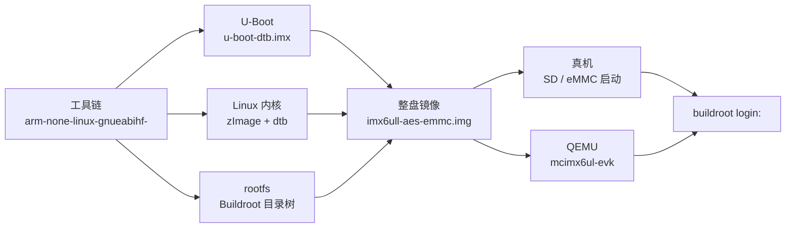

<PageHeader title="全流程串讲:从源码到 login" description="把前面六步按顺序合上:一条命令链,两块盘,两种启动方式" />

## 前言:分开学,合起来用

前面六步是拆开讲的:工具链、U-Boot、内核、rootfs、Buildroot、实战。拆开讲是为了看清每一步内部发生了什么,但真正干活时,它们是**一条首尾相接的流水线**——上一步的产物就是下一步的输入,中间任何一环换了版本,后面都要重跑。

这一章不再展开原理,只做三件事:

1. 把六步的输入输出串成一张图;
2. 给出本仓库里**可以直接照抄**的命令链(真机和 QEMU 两条);
3. 给一张"启动失败先看哪里"的对照表。

原理不清楚的地方,回 [硬件与启动原理](../hardware/) 补;某一步的细节,点表格里的章节链接。

## 先看全貌



| 阶段 | 干什么 | 产物 | 详细章节 |
| --- | --- | --- | --- |
| 00 | 弄懂硬件与启动链 | 脑子里的地图 | [硬件与启动原理](../hardware/) |
| 01 | 装交叉工具链 | `/opt/arm-gnu-toolchain` | [从 0 安装工具链](../start/01_start_from_toolchain) |
| 02 | 编译 U-Boot | `u-boot-dtb.imx` / `.bin` | [U-Boot 移植](../uboot/) |
| 03 | 编译内核与设备树 | `zImage` + `imx6ull-aes.dtb` | [内核移植](../kernel/) |
| 04 | 做根文件系统 | `rootfs/` 目录树 | [根文件系统](../rootfs/) · [Buildroot](../buildroot/) |
| 05 | 组装整盘镜像 | `*.img` + manifest | [镜像布局](../flash/06_image_layout_design) · [镜像脚本](../flash/07_build_imx6ull_image_script) |
| 06 | 启动并验证 | `buildroot login:` | 本章 · [模拟调试](../emu/) |

## 第 0 步:把环境摆好

所有命令都在仓库根目录执行。先确认工具链在 `PATH` 里:

```bash
export CROSS_COMPILE=arm-none-linux-gnueabihf-
export PATH=/opt/arm-gnu-toolchain/bin:$PATH

${CROSS_COMPILE}gcc --version | head -1
# arm-none-linux-gnueabihf-gcc (Arm GNU Toolchain 15.2.Rel1 ...) 15.2.1 ...
```

::: tip 工具链版本要对上
内核和 U-Boot 的编译都用这一套工具链。版本不一致时,最先出问题的地方往往是内核模块的 vermagic,而不是编译本身。工具链安装细节见 [01 工具链](../start/01_start_from_toolchain)。
:::

再确认仓库里的三个子模块都在:

```bash
ls third_party/
# uboot-mainline  linux_mainline  buildroot
```

## 第 1 步:U-Boot

```bash
./scripts/build_helper/build-uboot.sh
```

产物在 `out/uboot/`:

```text
out/uboot/
├── u-boot-dtb.bin     # 无头部,给 QEMU 的 -device loader 用
├── u-boot-dtb.imx     # 带 IVT/DCD,给真机 SD/eMMC 用
└── u-boot
```

两个文件差在哪?差在 `.imx` 头的 1KiB 和 DCD 里那 60 组寄存器写——[02 Boot ROM](../hardware/02_boot_rom) 已经逐字节拆过。

::: warning 第一次编译大概率会卡在 logo
如果构建脚本调用 `convert` 把 PNG 转 BMP 时报错,是主机缺 ImageMagick,与 U-Boot 代码无关。解决办法见 [U-Boot 编译](../uboot/02_uboot_compile)。
:::

## 第 2 步:内核与设备树

```bash
./scripts/build_helper/build-linux.sh
```

产物:

```text
out/linux/arch/arm/boot/zImage
out/linux/arch/arm/boot/dts/nxp/imx/imx6ull-aes.dtb
```

这一步里有两个"看起来像魔法"的动作,其实都是脚本代劳:

- `imx_aes_mainline_defconfig` 不在内核树里,是构建脚本用 `driver/device_tree/alpha-board/linux/imx6ull_mainline_defconfig.template` 现场生成的(把固件路径替换进去);
- 板级 `imx6ull-aes.dts/.dtsi` 也不在内核树里,是脚本从 `driver/device_tree/alpha-board/linux/` 拷进 `arch/arm/boot/dts/nxp/imx/` 并注册到 Makefile 的。

所以**改设备树要改 driver 目录下的源文件**,改完重跑构建;直接改 `third_party/linux_mainline` 下的副本,下次构建会被覆盖。细节见 [设备树写作](../kernel/07_dts_writing)。

## 第 3 步:根文件系统

工程化路线是 Buildroot:

```bash
./scripts/build_helper/build-buildroot.sh
```

产物是一棵 32MB 左右的目录树:

```text
out/release-latest/rootfs/
├── bin/  sbin/  usr/  lib/  etc/  ...
└── ...
```

第一次构建约 15 分钟(CI 最小配置)。想先手工搓一个 BusyBox 版本,看 [根文件系统](../rootfs/);想改包、加 Qt6、理解 br2-external,看 [Buildroot](../buildroot/)。

## 第 4 步:组装整盘镜像

先把材料凑齐到 `out/release-latest/`:

```text
out/release-latest/
├── uboot/u-boot-dtb.imx
├── linux/arch/arm/boot/zImage
├── linux/arch/arm/boot/dts/nxp/imx/imx6ull-aes.dtb
└── rootfs/
```

然后一条命令:

```bash
./scripts/image_builder/build_imx6ull_image.sh \
  --release-dir=out/release-latest \
  --device-tree=imx6ull-aes \
  --boot-media=emmc \
  --image-size-mb=128
```

产物:

```text
out/release-latest/images/
├── imx6ull-aes-emmc.img
├── imx6ull-aes-emmc.img.manifest
└── imx6ull-aes-emmc.img.sha256
```

盘里的布局是固定的:

| 偏移 | 内容 | 谁写的 |
| --- | --- | --- |
| `0x400`(1KiB) | U-Boot `.imx`(IVT/DCD 头部) | 构建脚本 `dd` |
| `0x400000`(4MiB) | 8KiB U-Boot 环境区(CRC 已修正) | `create_env_image()` |
| `0x1000000`(16MiB) | p1:ext4,`zImage`/`dtb`/`boot.scr` | `mke2fs -d` |
| `0x5000000`(80MiB) | p2:ext4,rootfs | `mke2fs -d` |

注意 `--boot-media=emmc` 不只是改文件名:它决定 U-Boot 从 `mmc 1` 找内核、内核 `root=/dev/mmcblk1p2`。接 SD 卡启动就传 `sd`,整套编号会跟着变。

::: details boot.scr 和环境区是脚本自动生成的
`boot.scr` 由 `boot.cmd` 经 `mkimage -T script` 生成;环境区则是从 U-Boot ELF 的 `default_environment` 符号里提出完整默认环境、算出 CRC32 后写进去的。前者让 U-Boot 自动 `source`,后者消掉 `bad CRC, using default environment`。为什么不能只写 `bootcmd`?因为 U-Boot 从 MMC 导入环境时会整体替换默认环境,只写一条 `bootcmd` 会把 `loadaddr`、`fdt_addr` 全弄丢。这一段踩坑记录见 [bring-up 笔记](../../notes/2026-11-13-qemu-bringup-progress)。
:::

## 第 5 步:启动

### 路线 A:真机

把镜像写到 SD 卡:

```bash
sudo dd if=out/release-latest/images/imx6ull-aes-emmc.img \
        of=/dev/sdX bs=4M conv=fsync status=progress
```

或者用 uuu 烧 eMMC。细节见 [烧录与进阶](../flashing/)。串口 115200 8N1,应当看到:

```text
U-Boot 2026.10 (Nov 13 2026 - ...)
DRAM:  512 MiB
Loading Environment from MMC... OK
...
buildroot login:
```

### 路线 B:QEMU

QEMU 没有 Boot ROM,`-bios` 载不了带 IVT 的 `.imx`。绕法是 `-device loader` 直接把无头部的 `u-boot-dtb.bin` 放到 `0x87800000`,再让 CPU 从那儿取指:

```bash
out/qemu/build/qemu-system-arm \
  -M mcimx6ul-evk -m 512M \
  -device loader,file=out/release-latest/uboot/u-boot-dtb.bin,addr=0x87800000,cpu-num=0 \
  -drive file=out/release-latest/images/imx6ull-aes-emmc.img,if=sd,index=1,format=raw \
  -nographic
```

预期输出(节选):

```text
U-Boot 2026.10-dirty (Nov 13 2026 - 02:27:08 +0800)
CPU:   Freescale i.MX6UL rev1.0
DRAM:  512 MiB
MMC:   FSL_SDHC: 0, FSL_SDHC: 1 (SD)
Loading Environment from MMC... OK
...
9260808 bytes read in 2004 ms (4.4 MiB/s)
35519 bytes read in 9 ms (3.8 MiB/s)
...
[    5.9] Run /sbin/init as init process
...
buildroot login:
```

从通电到 login 约 20 秒——分解见 [08 完整流程](../hardware/08_full_flow)。

::: info QEMU 的二进制从哪来
系统自带的 QEMU 8.2 跑不动全套(MMDC/OCOTP 是地址空洞,uSDHC 也有坑)。本仓库用 `scripts/build_helper/build-qemu.sh` 在 `third_party/qemu` 上打 27 个补丁编译,产物在 `out/qemu/build/qemu-system-arm`。构建过程与补丁说明见 [模拟与调试](../emu/)。
:::

### 路线 C:只想快速验证内核(rootfs)

如果你还没有 U-Boot 产物,只想先看内核能不能起来,用直启:

```bash
./scripts/qemu_helper/run-qemu.sh
```

它走 `-kernel zImage -dtb` 直启,不经过 U-Boot。两条路线的差异见 [03 rootfs 镜像](../emu/03_rootfs_image)。

## 或者:一条命令跑完全部

`release-all.sh` 把第 1–4 步串了起来:

```bash
./scripts/release-all.sh --boot-media emmc
```

它按顺序调用 U-Boot、内核、Buildroot、rootfs 校验、镜像组装五个阶段,产物落在 `out/release-latest/`。适合"代码没改、只想重出一块盘"的场景;第一次跑或要看清每一步输出,还是建议按上面的顺序手动执行。

::: warning 一条命令不等于一键完成
脚本会检查依赖和产物,但不会替你装 `ninja`、`imagemagick`、`unzip` 这些主机工具。缺什么它会直接报出来,按提示补即可;本项目在无 root 环境下用本地解包的方式补齐过,记录见 [bring-up 笔记](../../notes/2026-11-13-qemu-bringup-progress)。
:::

## 启动失败先看哪里

| 现象 | 最可能的原因 | 去哪查 |
| --- | --- | --- |
| 串口完全没输出 | 没接对 UART、波特率不对、板子没供电 | [07 UART](../hardware/07_uart_display) |
| 有 U-Boot 但 `DRAM: 16 MiB` | MMDC 读回 0,几何信息丢失 | [03 DDR 与 MMDC](../hardware/03_ddr_mmdc) |
| `bad CRC, using default environment` | 环境区没写或 CRC 不对 | 本章第 4 步 |
| `Card did not respond to voltage select` | 卡没插好,或 `if=sd,index=` 选错 | [06 SD/eMMC](../hardware/06_storage) |
| `ext4load ... Usage` | 变量是空的(`loadaddr` 未定义) | [Bring-up 笔记](../../notes/2026-11-13-qemu-bringup-progress) |
| 内核起来但 `VFS: Unable to mount root` | `root=` 与分区号不匹配 | [镜像布局](../flash/06_image_layout_design) |
| 屏幕花屏/无显示 | LCD 时序或背光 | [07 显示](../hardware/07_uart_display) · [LCD 移植](../uboot/06_lcd_porting) |
| 内核 panic 在某个外设 | 设备树节点与硬件不符 | [内核常见问题](../kernel/13_common_issues) |

## 一页速查

```bash
# 0. 环境
export CROSS_COMPILE=arm-none-linux-gnueabihf-
export PATH=/opt/arm-gnu-toolchain/bin:$PATH

# 1-3. 三个组件
./scripts/build_helper/build-uboot.sh
./scripts/build_helper/build-linux.sh
./scripts/build_helper/build-buildroot.sh

# 4. 组装镜像
./scripts/image_builder/build_imx6ull_image.sh \
  --release-dir=out/release-latest --device-tree=imx6ull-aes \
  --boot-media=emmc --image-size-mb=128

# 5A. 真机:写卡
sudo dd if=out/release-latest/images/imx6ull-aes-emmc.img of=/dev/sdX bs=4M conv=fsync

# 5B. QEMU:U-Boot 全链
out/qemu/build/qemu-system-arm -M mcimx6ul-evk -m 512M \
  -device loader,file=out/release-latest/uboot/u-boot-dtb.bin,addr=0x87800000,cpu-num=0 \
  -drive file=out/release-latest/images/imx6ull-aes-emmc.img,if=sd,index=1,format=raw \
  -nographic
```

::: details 本章没有讲什么
- 每个阶段的**内部原理**:见对应卷;硬件层见 [00 硬件与启动原理](../hardware/)。
- QEMU 的机型模型、补丁清单、打地鼠过程:见 [模拟与调试](../emu/)。
- 驱动开发:从 [驱动与实战](../driver-dev/) 开始。
- 命令速查:[命令手册](../commands/)。
:::
